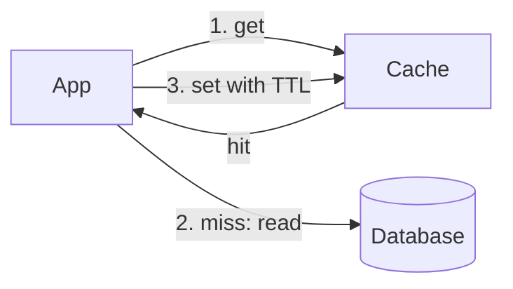

Cache-aside pone un almacén rápido junto a la base de datos, y es la aplicación, no el almacén, la que decide qué entra en él.

## Cuándo usarlo

- Las lecturas superan a las escrituras, y la CPU de la base de datos sube con el tráfico.
- Un conjunto pequeño de filas atrae la mayoría de las lecturas, como la página de un producto el día del lanzamiento.
- Una respuesta ligeramente obsoleta es aceptable durante unos segundos.

## Cómo funciona

En una lectura, la app pregunta primero a la caché. Un acierto (hit) responde al instante. Un fallo (miss) lee la base de datos, escribe la respuesta en la caché con un TTL y la devuelve. En una escritura, la app actualiza la base de datos y borra la clave en caché, para que la siguiente lectura la vuelva a llenar.

Si el 90% de las lecturas aciertan, la base de datos ve una décima parte del tráfico. Subir del 90% al 99% lo vuelve a dividir por diez, así que los últimos puntos de tasa de aciertos son los que más valen.

## Qué cuesta

Los datos pueden estar obsoletos tanto como dure el TTL, y una clave borrada puede competir con un lector lento que vuelve a escribir el valor viejo. Una caché fría envía todas las lecturas a la base de datos a la vez, y una clave popular que caduca bajo carga hace que muchos lectores la reconstruyan juntos, lo que es una [estampida de caché](/glossary/cache-stampede).

## En Quorum

Coloca una [Caché](/components/cache) delante de la Base de datos e investiga [Caché](/research/caching). La estrategia por defecto de la Caché es cache-aside, así que el Diseño la muestra con un TTL y un tamaño.

::Design{id="cache-aside"}

El incidente [Estampida de caché](/incidents/stampede) muestra el problema de la caché fría, y [Protección contra estampidas](/research/stampede-protection) es la solución. El glosario define [cache-aside](/glossary/cache-aside).
