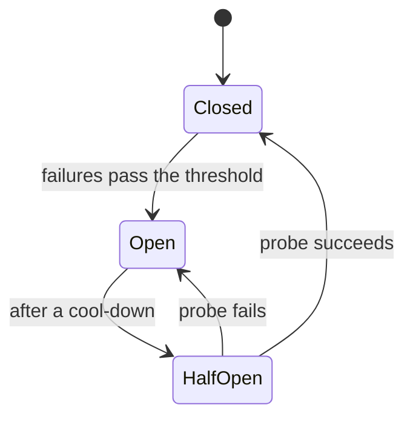

Un circuit breaker (cortacircuitos) impide que quien llama martille una dependencia que ya está fallando.

## Cuándo usarlo

- Una dependencia puede fallar durante minutos, no milisegundos.
- Los llamadores se acumulan esperándola, y la acumulación empieza a dañar a servicios que no hicieron nada mal.
- Tienes una alternativa razonable: un valor en caché, un valor por defecto o un error claro.

## Cómo funciona

El breaker cuenta las llamadas recientes y está en uno de tres estados.

Cerrado (closed) deja pasar todas las llamadas. Abierto (open) hace fallar todas las llamadas al instante, sin tocar la dependencia. Semiabierto (half-open) deja pasar una sonda. Cuando los fallos superan un umbral, por ejemplo la mitad de las llamadas recientes, el breaker se abre durante unos segundos. Los llamadores reciben un error inmediato en lugar de una espera de 30 segundos, y la dependencia tiene un respiro para drenar.

## Qué cuesta

Los umbrales son conjeturas. Un breaker que salta con demasiada facilidad aísla a un servicio sano, y uno que salta demasiado tarde no protege nada. Un breaker abierto también significa que algunos usuarios ven la alternativa cuando la dependencia habría respondido a unas pocas de sus llamadas. Usa un breaker por dependencia, nunca uno para todo, o un servicio malo bloqueará a todos los demás.

## En Quorum

::Design{id="breaker-on"}

El Diseño repite el Enlace con backoff de [Reintentar con backoff](/patterns/retry-with-backoff) y añade **Breaker**. El pie de imagen coincide con el del Diseño con backoff, porque un breaker actúa en el tiempo: la Simulación lo abre en el Paso siguiente a que la proporción de fallos del Enlace supere el umbral del breaker, y una única resolución del estado estable no puede mostrarlo. Jugando, el Enlace abierto hace fallar las llamadas al instante durante unos segundos, luego vuelve a intentarlo, y la Base de datos tiene un respiro para drenar.

Elige **Breaker** en un Enlace después de investigar [Circuit breakers](/research/circuit-breakers), que necesita [Backoff con jitter](/research/backoff-jitter). Un Service mesh ejecuta su propio breaker en cada Enlace que sale de un Nodo con sidecar. [Detener una tormenta de reintentos](/guides/stop-a-retry-storm) lo usa. El glosario define [circuit breaker](/glossary/circuit-breaker) y [fallo en cascada](/glossary/cascading-failure).
