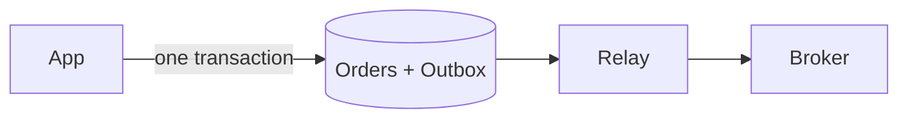

El outbox transaccional convierte "guardar el pedido y anunciarlo" en un único paso atómico.

## Cuándo usarlo

- Un cambio en tu base de datos también debe producir un mensaje, como `OrderPlaced`.
- Perder el mensaje, o enviar un mensaje por un cambio revertido, corrompería a otro servicio.

## Cómo funciona

El código ingenuo guarda la fila y luego publica en el broker. Si el proceso muere entre ambos pasos, la fila existe y nadie se entera. Si inviertes el orden, un guardado fallido deja un mensaje sobre nada. Los dos sistemas no pueden compartir una transacción.

Así que la aplicación inserta el evento en una tabla `outbox` dentro de la misma transacción que el pedido. Un proceso relay lee las filas nuevas del outbox y las publica, y luego las marca como enviadas. Una caída después de publicar y antes de marcar envía el evento dos veces, así que los consumidores deben manejar duplicados.

## Qué cuesta

Los eventos llegan algo después del commit, porque el relay consulta periódicamente o sigue el log. Ejecutas y vigilas un proceso más, y la tabla del outbox necesita limpieza. La entrega es al menos una vez, así que se requieren [consumidores idempotentes](/patterns/idempotency-keys).

## En Quorum

::Design{id="outbox-search"}

Los demás Nodos de la imagen solo atienden los otros tipos de petición de la Serie B, como los pagos y el tiempo real. Investiga [Outbox transaccional](/research/outbox) y el juego deja de contar la pérdida por escritura doble: desde la Serie B, una parte de las respuestas de búsqueda está obsoleta cuando la aplicación escribe por separado en la Base de datos y en el [Motor de búsqueda](/components/search) y nada transporta el cambio. El outbox es una Investigación, no un Nodo, así que el Diseño solo muestra su efecto y no tiene ajuste propio. Un [Conector CDC](/components/cdc) elimina la misma pérdida leyendo el log de la Base de datos, algo que cubre la [Captura de cambios de datos](/patterns/change-data-capture). El glosario define el [outbox transaccional](/glossary/transactional-outbox).
