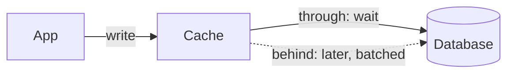

Una caché write-through escribe en la base de datos antes de responder, y una caché write-behind responde primero y escribe después.

## Cuándo usarlo

- Cache-aside deja a los usuarios leyendo filas viejas justo después de una escritura, y lo ves en los informes de lecturas obsoletas.
- Las escrituras a las mismas pocas claves llegan en ráfagas, así que agruparlas ahorraría trabajo a la base de datos (write-behind).
- Los datos toleran una breve ventana de pérdida si la caché se cae (solo write-behind).

## Cómo funciona

Con write-through, la aplicación escribe en la caché, la caché escribe en la base de datos, y solo entonces vuelve la llamada. La caché nunca discrepa de la base de datos, así que las lecturas no necesitan invalidación. Con write-behind, la caché confirma al instante y vuelca lotes a la base de datos con un temporizador. Un contador incrementado 100 veces en un segundo puede llegar a la base de datos como una sola actualización.

## Qué cuesta

Write-through añade el tiempo de escritura de la caché a cada escritura y llena la caché con claves que nadie lee. Write-behind es más rápido y más barato para la base de datos, pero una caída pierde lo que aún no se había volcado, y mientras tanto la base de datos va por detrás de la caché. Úsalo para contadores y "me gusta", nunca para pagos.

## En Quorum

La [Caché](/components/cache) tiene una opción de Estrategia de caché, y elegir cualquiera distinta de cache-aside necesita [Estrategias de caché](/research/cache-strategies). Los dos Diseños de abajo se diferencian de cache-aside solo en la estrategia, así que sus pies de figura muestran lo que cambia.

::Design{id="cache-write-through"}

::Design{id="cache-write-behind"}

El incidente [Lecturas obsoletas](/incidents/stale-read) muestra por qué importa la estrategia. El glosario define la [caché write-through](/glossary/write-through-cache).
