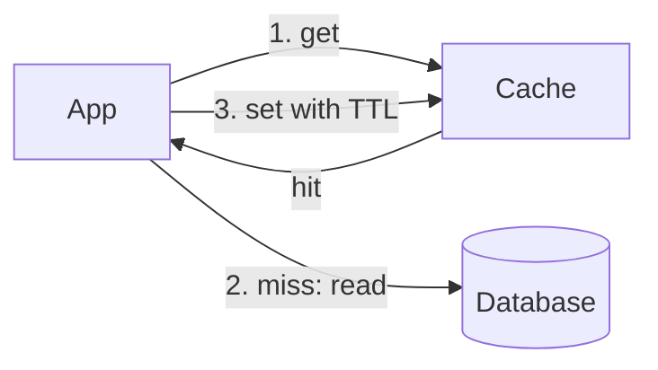

キャッシュアサイドはデータベースの隣に速いストアを置き、そこに何を入れるかをストアではなくアプリケーションが決めます。

## 使う場面

- 読み取りが書き込みより多く、データベースの CPU がトラフィックとともに上がります。
- ローンチ日の商品ページのように、少数の行が読み取りの大半を集めます。
- 数秒の古さなら受け入れられます。

## 仕組み

読み取りでは、アプリがまずキャッシュに問い合わせます。ヒットすればすぐ返ります。ミスならデータベースを読み、答えを TTL 付きでキャッシュに書き、返します。書き込みでは、アプリがデータベースを更新し、キャッシュされたキーを削除するので、次の読み取りがそれを埋め直します。

読み取りの 90% がヒットすれば、データベースに届くのは 10 分の 1 です。90% から 99% に上がるとさらに 10 分の 1 になるので、ヒット率の最後の数ポイントが最も価値があります。

## コスト

データは TTL の間、古いままになりえますし、削除したキーが遅い読み手と競合して古い値を書き戻すこともあります。コールドなキャッシュはすべての読み取りを一度にデータベースへ送りますし、負荷の下で期限が切れた人気のキーは多くの読み手を一斉に再構築へ向かわせます。これが[キャッシュスタンピード](/glossary/cache-stampede)です。

## Quorum では

データベースの前に[キャッシュ](/components/cache)を置き、[キャッシュ](/research/caching)をリサーチします。キャッシュの既定の戦略はキャッシュアサイドなので、設計には TTL とサイズが表示されます。

::Design{id="cache-aside"}

[キャッシュスタンピード](/incidents/stampede)のインシデントがコールドキャッシュの問題を示し、[スタンピード対策](/research/stampede-protection)がその修正です。用語集が[キャッシュアサイド](/glossary/cache-aside)を定義しています。
