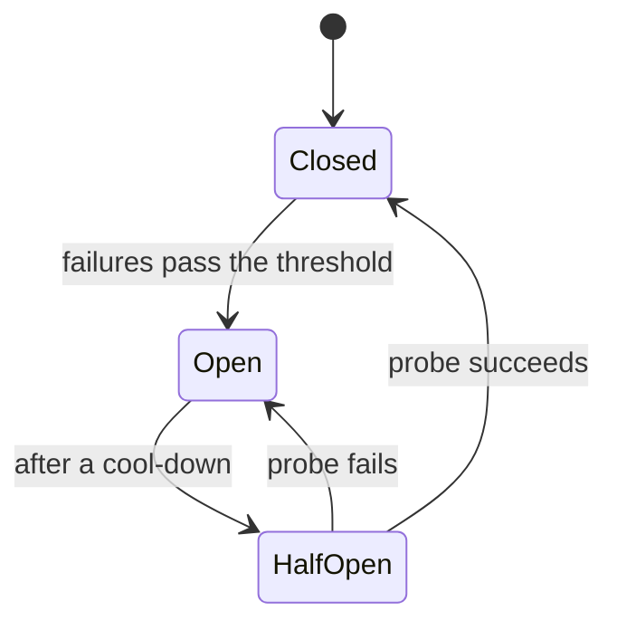

サーキットブレーカーは、すでに失敗している依存先を呼び出し元が叩き続けるのを止めます。

## 使う場面

- 依存先がミリ秒ではなく分単位で失敗しえます。
- 呼び出し元がそれを待って積み上がり、その山が何も悪くないサービスを傷つけ始めます。
- まともなフォールバックがあります。キャッシュされた値、既定値、明確なエラーです。

## 仕組み

ブレーカーは最近の呼び出しを数え、3 つの状態のどれかにいます。

Closed はすべての呼び出しを通します。Open は依存先に触れずにすべての呼び出しを即座に失敗させます。Half-open は 1 つの探りを通します。失敗がしきい値、たとえば最近の呼び出しの半分を超えると、ブレーカーは数秒間開きます。呼び出し元は 30 秒の待ちではなく即座のエラーを受け取り、依存先は処理を吐き出す静かな時間を得ます。

## コスト

しきい値は推測です。簡単に切れるブレーカーは健全なサービスを切り離し、遅く切れるブレーカーは何も守りません。開いたブレーカーは、依存先なら答えていたはずの呼び出しについて、一部のユーザーにフォールバックを見せることでもあります。ブレーカーは依存先ごとに 1 つ使い、すべてに 1 つにしてはいけません。1 つの悪いサービスが他のすべてを塞ぎます。

## Quorum では

::Design{id="breaker-on"}

設計は[バックオフ付きリトライ](/patterns/retry-with-backoff)のバックオフのリンクを繰り返し、**ブレーカー**を足します。キャプションはバックオフの設計と一致します。ブレーカーは時間をかけて働くからです。シミュレーションはリンクの失敗割合がブレーカーのしきい値を超えた次のステップでそれを開き、定常状態を 1 回解くだけではそれは示せません。プレイでは、開いたリンクは数秒間呼び出しを即座に失敗させ、その後また試し、データベースは処理を吐き出す静かな時間を得ます。

[サーキットブレーカー](/research/circuit-breakers)をリサーチした後、リンクで**ブレーカー**を選びます。それには[ジッター付きバックオフ](/research/backoff-jitter)が必要です。サービスメッシュは、サイドカーを持つノードからの各リンクで独自のブレーカーを動かします。[リトライストームを止める](/guides/stop-a-retry-storm)がそれを使います。用語集が[サーキットブレーカー](/glossary/circuit-breaker)と[連鎖障害](/glossary/cascading-failure)を定義しています。
