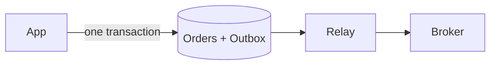

トランザクショナルアウトボックスは、「注文を保存して知らせる」を 1 つの原子的なステップにします。

## 使うとき

- データベースの変更が、`OrderPlaced` のようなメッセージも生まなければならないとき。
- メッセージを失うこと、またはロールバックした変更のメッセージを送ることが、別のサービスを壊すとき。

## 仕組み

素朴なコードは行を保存し、そのあとブローカーへ発行します。2 つの間でプロセスが死ぬと、行は存在するのに誰もそれを聞きません。順番を入れ替えると、失敗した保存が何でもないメッセージを残します。2 つのシステムは 1 つのトランザクションを共有できません。

そこでアプリは、注文と同じトランザクションの中でイベントを `outbox` テーブルに挿入します。リレーのプロセスが新しい outbox の行を読み、発行し、送信済みに印を付けます。発行のあと印を付ける前にクラッシュするとイベントは 2 回送られるので、コンシューマーは重複を扱う必要があります。

## コスト

イベントはコミットより少し遅れて届きます。リレーがログをポーリングするか末尾を追うためです。プロセスがもう 1 つ増えて監視し、outbox テーブルの掃除も必要です。配信は at-least-once なので、[冪等なコンシューマー](/patterns/idempotency-keys)が必要です。

## Quorum では

::Design{id="outbox-search"}

絵の中の他のノードは、チェックアウトやリアルタイムなどシリーズ B の他のリクエスト種別に答えるだけです。[トランザクショナルアウトボックス](/research/outbox)をリサーチすると、ゲームは二重書き込みの損失を数えなくなります。シリーズ B 以降、アプリがデータベースと[検索エンジン](/components/search)に別々に書き、変更を運ぶものがないと、検索の答えの一部が古くなります。アウトボックスはノードではなくリサーチなので、設計はその効果だけを示し、独自の設定はありません。[CDCコネクター](/components/cdc)はデータベースのログを読んで同じ損失を取り除き、それは[変更データキャプチャ](/patterns/change-data-capture)が扱います。用語集は[トランザクショナルアウトボックス](/glossary/transactional-outbox)を定義しています。
