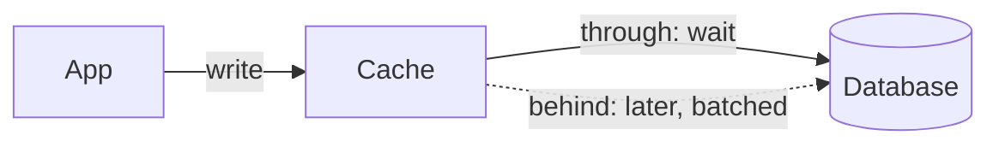

ライトスルーのキャッシュは答える前にデータベースへ書き、ライトビハインドのキャッシュは先に答えてあとで書きます。

## 使うとき

- キャッシュアサイドだと、書き込みの直後にユーザーが古い行を読み、それが古い読み取りのレポートに見えるとき。
- 同じ少数のキーへの書き込みがバーストで届き、まとめればデータベースの仕事を減らせるとき（ライトビハインド）。
- キャッシュが落ちてもデータが短い喪失期間を許容できるとき（ライトビハインドのみ）。

## 仕組み

ライトスルーでは、アプリがキャッシュに書き、キャッシュがデータベースに書き、そのあとでようやく呼び出しが戻ります。キャッシュがデータベースと食い違うことはないので、読み取りに無効化は要りません。ライトビハインドでは、キャッシュがすぐに確認し、タイマーでバッチをデータベースへ流します。1 秒間に 100 回増えたカウンターは、1 回の更新としてデータベースに届きます。

## コスト

ライトスルーはすべての書き込みにキャッシュの書き込み時間を足し、誰も読まないキーでキャッシュを埋めます。ライトビハインドはより速く、データベースにも安く済みますが、クラッシュするとまだ流していないものを失い、その間データベースはキャッシュより遅れます。カウンターやいいねには使い、決済には決して使いません。

## Quorum では

[キャッシュ](/components/cache)にはキャッシュ戦略のオプションがあり、キャッシュアサイド以外を選ぶには[キャッシュ戦略](/research/cache-strategies)が必要です。下の 2 つの設計はキャッシュアサイドと戦略だけが違うので、キャプションはそれが何を変えるかを示します。

::Design{id="cache-write-through"}

::Design{id="cache-write-behind"}

[古い読み取り](/incidents/stale-read)のインシデントが、戦略がなぜ重要かを示します。用語集は[ライトスルーキャッシュ](/glossary/write-through-cache)を定義しています。
